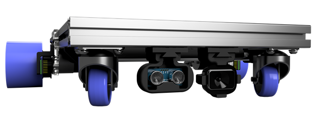

# SCUTTLE™ Robot
* This repository contains software (embedded Linux & Python) for the SCUTTLE Project.
* Hardware designs are arranged in the SCUTTLE Tech Guide, a separate repository.
  * See [SCUTTLE Tech Guide](https://github.com/dmalawey/ScuttleTechGuide) Repo
  * View [Tech Guide as a Website](https://qr.net/scuttleproject)   

### Sensing, Connected, Utility Transport Taxi for Level Environments
* payload capable (40kg)
* maker-friendly
* open source
* low-cost

### Visit the [SCUTTLE™ Webpage](https://qr.net/scuttleproject).

### License
This work is licensed under the Creative Commons Attribution-ShareAlike 4.0 License.  To view details [visit creativecommons.org](https://creativecommons.org/licenses/by-sa/4.0/legalcode)
